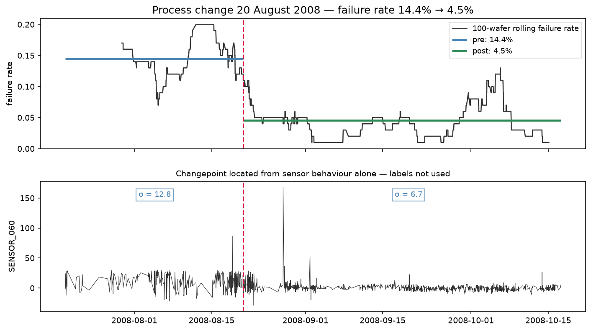
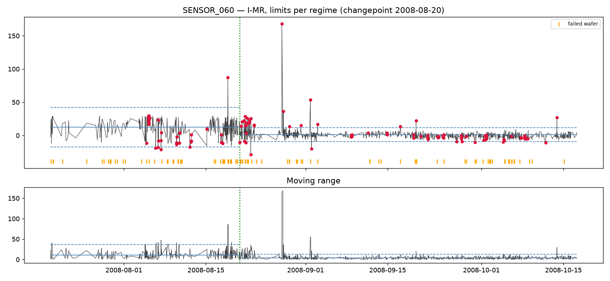
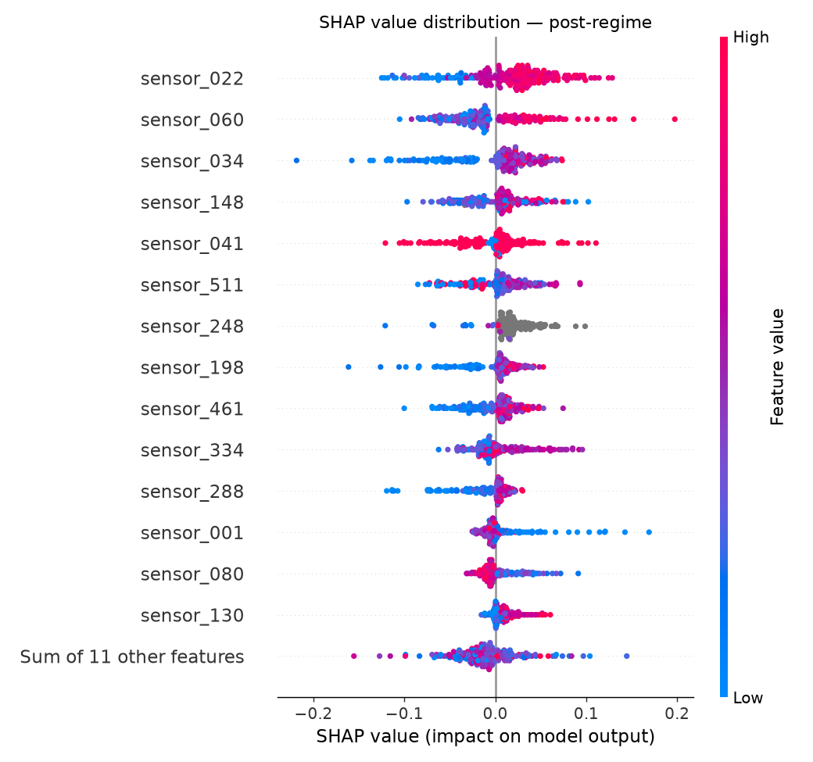
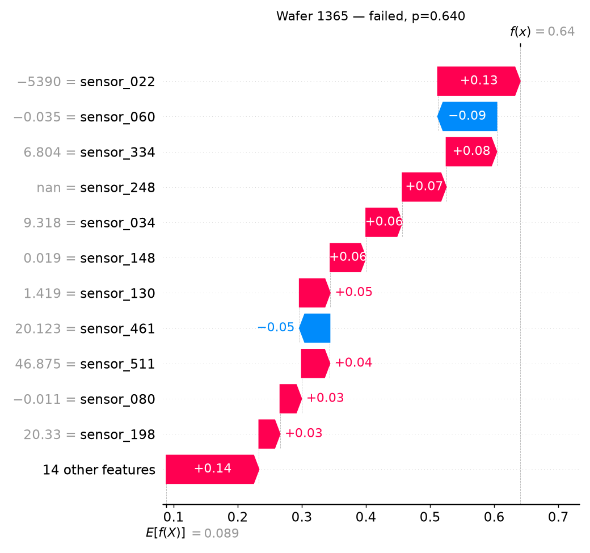

# SECOM — Process Quality Analysis

Semiconductor manufacturing process data: 1,567 wafers, 590 anonymised sensors,
6.6 % failure rate. Snowflake + dbt for the data layer, Python for statistics,
process control and explainability.



---

## Findings

**1. The process changed on 20 August 2008, and yield tripled.**
A changepoint search on sensor behaviour alone — labels not used — places the
break at 2008-08-20 17:36. Failure rate before: **14.41 %**. After: **4.54 %**.

**2. Models trained across that boundary learn a mixture of two processes and
generalise to neither.** Cross-validation fold scores were
`[0.19, 0.06, 0.06, 0.46, 0.05]` — the high fold is the one straddling the
change. This, rather than insufficient data, explains the unstable results.

**3. SENSOR_060 is the dominant signal, confirmed by three independent methods.**
Rank 1 by univariate Mann-Whitney, rank 1 by mean |SHAP|, and a control-chart
lift of **3.01**. Wafers violating its I-MR chart in the post-change regime fail
at **12.0 % (95 % CI 6.7–20.8 %)** against a 4.0 % baseline — odds ratio 3.29,
Fisher exact one-sided **p = 0.003**. That survives Bonferroni correction across
the five sensors charted.

**4. No deployable failure predictor exists on this data.**
The best honest result is roughly 3× the no-skill baseline, with confidence
intervals spanning no-skill. Reported as such rather than tuned until a
flattering number appeared.

**5. The sensor set contains substantial hidden redundancy.** 25 of 440 columns
are monotonic transforms of another column — found by a pairwise check that
single-column profiling cannot perform.

---

## Data and its limits

| | |
|---|---|
| Source | [UCI SECOM](https://archive.ics.uci.edu/dataset/179/secom) |
| Wafers | 1,567, timestamped July–October 2008 |
| Sensors | 590, **anonymised** |
| Failures | 104 (6.6 %) |

Feature anonymisation is the binding constraint on interpretation. This analysis
can say *which* sensor separates failures and by how much; it cannot say what
that sensor measures. The output is therefore a **method** — a route from raw
process data to an actionable monitoring rule — rather than a plant diagnosis.
Where a real deployment would consult a process engineer, this write-up says so.

---

## Route

### Data layer

Raw loaded to Snowflake with **explicit DDL** rather than inferred typing, so the
schema is a versioned decision rather than a by-product of pandas' inference.
(The first load used `auto_create_table=True` and silently typed the timestamp
column as `NUMBER`, storing nanoseconds since epoch. Hence the change.)

Two dbt models, deliberately split:

- `stg_secom` — median-imputed, for warehouse-side consumers such as dashboards
- `stg_secom_features` — **nulls preserved**, so imputation can happen inside the
  scikit-learn `Pipeline` and be fitted on training folds only

Column selection is driven by a versioned seed and profiling thresholds:

| Stage | Sensors |
|---|---|
| Raw | 590 |
| After single-column profiling | 440 |
| After pairwise redundancy check | **415** |

Single-column profiling drops all-null, constant, near-constant (one value
covering ≥ 99 % of non-nulls) and > 50 % null columns. Near-constant is a
separate check from constant because a column can have several distinct values
and still be 99.8 % one number — statistically useless, but `n_unique > 1`.

Four dbt tests cover uniqueness, nullability and accepted values.

### Modelling

Chronological 80/20 split throughout, `TimeSeriesSplit` for cross-validation.
A random split would let the model learn from wafers processed *after* the ones
it predicts, which no production system can do.

**PR-AUC only.** At 6.9 % prevalence a classifier predicting "pass" every time
scores 93 % accuracy. The no-skill PR-AUC equals the prevalence, and every score
below is stated against that floor.

| Model | CV PR-AUC | Test |
|---|---|---|
| No-skill | 0.0694 | — |
| Logistic regression | 0.0768 ± 0.0426 | 0.1709 |
| HistGradientBoosting | 0.1615 ± 0.1556 | 0.0866 |
| **Shuffled-target control** | **0.0828** | — |

The shuffled-target control is the important row: a deliberately destroyed target
outscored the logistic regression. Combined with fold standard deviations
exceeding the means, and CV and test columns disagreeing in *opposite directions*
for the two models, the conclusion was no usable signal at this level.

`HistGradientBoostingClassifier` is used rather than XGBoost or LightGBM: both
require an OpenMP runtime unavailable in this environment. It handles nulls
natively via learned default directions and needs no scaling, so no imputer or
scaler appears in its pipeline.

### Why the model failed — univariate screening

A weak model does not prove absent signal, so each sensor was tested
individually: Mann-Whitney (distributions are skewed and non-normal) with
Benjamini-Hochberg FDR correction.

- **65 sensors at raw p < 0.05** — against ~21 expected by chance across 415 tests
- **25 survive FDR at q < 0.10**

Signal exists. The revised conclusion: roughly twenty-five sensors carry weak
individual associations that a wide model cannot isolate from 87 positive
training examples.

Refitting on the screened features collapsed the fold standard deviation from
0.156 to 0.058 and raised the worst fold from 0.048 to 0.079. The mean gain
stayed inside noise, but the **stability** improvement is evidence that the
remaining sensors contributed variance rather than signal.

> **Caveat, stated rather than hidden:** the screening used the full training set,
> so scores from the screened-feature model are optimistically biased. The clean
> version nests feature selection inside each CV fold.

### Statistical process control — and a mistake

I-MR charts (individuals and moving range) rather than X̄-R: SECOM provides one
measurement per wafer per sensor with no rational subgroups, so there is nothing
to average within.

**The first pass was wrong.** Phase I limits were taken on faith from the first
30 % of the series, and lift was computed across the whole period. The result:
1,179 of 1,567 points flagged, and lift *below 1* — flagged wafers appearing to
fail less often than clean ones.

Two errors. The reference window was not in control, violating the basic
requirement that Phase I limits come from a stable period. And because the
regime change coincides with the drop in failure rate, "violating" had become a
proxy for "late period" — the table was measuring calendar time, not sensor
behaviour.

The correction: detect the changepoint, chart each regime against its own
iteratively-cleaned Phase I window, and compute lift **within** regime so time is
controlled for. Nelson Rule 2 was also fixed to flag only from the ninth point of
a run onward rather than every point in it.



All lifts inverted to above 1.

| Sensor | Regime | Flagged | Fail rate flagged | Fail rate clean | Lift |
|---|---|---|---|---|---|
| **SENSOR_060** | **post** | **83** | **12.05 %** | **4.00 %** | **3.01** |
| SENSOR_511 | post | 111 | 6.31 % | 4.36 % | 1.45 |
| SENSOR_248 | post | 149 | 5.37 % | 4.42 % | 1.21 |
| SENSOR_104 | post | 135 | 5.19 % | 4.46 % | 1.16 |

Fisher exact was used rather than chi-square: with 10 events in one cell the
chi-square approximation is unreliable.

SENSOR_060's lift is **0.40 in the pre-regime** — the relationship holds only
after the process change, and is reported as regime-specific rather than as a
universal rule.

Nelson Rule 3 (six-point trend) fired twice in 1,567 points. The mechanism is
discrete excursions, not drift, which makes I-MR the appropriate chart and means
EWMA or CUSUM would add little here.

### Attribution

SHAP was scoped to the **post-regime process only** (1,234 wafers, 56 failures).
Explaining a model fitted across the boundary would contradict the finding that
the two periods are different processes.

Within that regime: CV PR-AUC 0.1219 ± 0.0969 against a no-skill floor of 0.0426.
The best lift in the project — and still inside noise, on 14 test failures.



The purpose is convergence, not accuracy. SENSOR_060 ranks 1 by both SHAP and
univariate test; SENSOR_511 ranks 5 by both. Rank agreement across all screened
features is near zero (Spearman −0.05), which is exactly what a few-real-signals
structure predicts: **the methods agree at the top of the ranking and not below
it**, because below the top there is nothing to agree about.

SENSOR_022, 034 and 041 rank high by SHAP but low univariately — candidate
interaction effects, invisible to a univariate test by construction.



### Data quality — a gap in the profiling

SENSOR_248 and SENSOR_520 produced identical control-chart rows. They are
perfectly rank-correlated with identical null patterns, and a linear fit gives:

```
SENSOR_520 = 228.3 × SENSOR_248 − 0.457
```

A unit conversion or fixed calibration factor, not two independent measurements.
A systematic check across all 440 columns found this was not isolated:

- **27 pairs at |Spearman| ≥ 0.999**, forming **23 redundant groups**
- **25 columns dropped**, every one with an identical null pattern to its partner

The column indices reveal the structure. Eighteen pairs sit at a near-constant
offset of **271–273** (`148→421`, `154→427`, `173→444`, `248→520`, `269→541` …),
which suggests a block of roughly 270 sensors appears twice in the file, the
second copy rescaled. A second family sits at offsets of 2–4 (`035/037`,
`308/310`, `584/586`) — adjacent columns, probably raw-and-derived pairs within
one logging group.

The clearest single case: **SENSOR_035 = 100 − SENSOR_037**, slope exactly −1,
intercept exactly 100, r² = 1.0. A percentage and its complement.

This exposed a real gap in the pipeline. Profiling checked *single-column*
properties and cannot detect redundancy that is a *pairwise* property. A
|Spearman| > 0.999 pair check now runs during profiling, with `min_periods=30`
so that sparse columns sharing a handful of non-null rows don't register as
duplicates by accident.

**Robustness check.** The full analysis was re-run on the deduplicated 415
columns. FDR survivors fell from 30 to 25 — the five lost were duplicate
measurements counted twice, not signal. SENSOR_060 remained rank 1 with an
identical effect size of 0.4551, and the top five were unchanged apart from the
removed duplicate. **No conclusion changed.**

---

## Caveats

- 590 anonymised features; no physical interpretation is available
- 104 failures total, 56 in the post-change regime, 14 in its test set — every
  metric quoted is coarse and confidence intervals are wide
- Feature screening was not nested inside cross-validation (see above)
- The changepoint is detected, not known; no process log accompanies the dataset
- The changepoint search assumes a single break; a process with several smaller
  shifts would need a multi-changepoint method
- SENSOR_104 and SENSOR_511 correlate at 0.626 and may reflect one mechanism
  rather than two

---

## With real feature names

The analysis stops where a real deployment would begin. With sensor identities
available, the next steps would be:

1. **Map the top sensors to process steps.** SENSOR_060's three-fold lift is
   actionable only once someone knows which tool or chamber it monitors.
2. **Reconcile the changepoint against the maintenance log.** A recipe change,
   chamber clean or tool replacement on 20 August would convert a statistical
   observation into a root cause — and, if the change is known and repeatable,
   into a yield improvement worth generalising.
3. **Resolve the duplicated sensor block.** A 270-column offset pattern is a
   logging or export artefact worth fixing upstream, not just downstream.
4. **Add missingness indicators.** A missing sensor reading in fab data often
   means a skipped step or an offline tool, which is itself informative rather
   than merely absent.
5. **Deploy the SPC rule, not the classifier.** An I-MR chart on a handful of
   named sensors is interpretable, maintainable by process engineers and
   defensible in an audit. A weak multi-feature model is none of those things.

---

## Reproducing

```bash
# environment
python3.12 -m venv .venv && source .venv/bin/activate
pip install -r requirements.txt

# warehouse (needs ~/.dbt/profiles.yml with key-pair auth)
python analysis/setup_snowflake.py     # database and schema
python analysis/load_secom.py          # explicit DDL, then load

cd dbt/secom && dbt build              # models + tests
```

Then, in order:

| Script | Produces |
|---|---|
| `pair_redundancy.py` | redundant-group detection, drop list |
| `profile_secom.py` | column profile, kept-sensor list |
| `build_dataset.py` | chronological train/test split |
| `gradientboosting.py` | baseline, GBM, shuffled control |
| `univariate.py` | Mann-Whitney screening with FDR |
| `control_charts.py` | changepoint, per-regime I-MR, lift table |
| `validate_findings.py` | Fisher exact, Wilson CI, correlation check |
| `shap_analysis.py` | post-regime attribution, convergence check |
| `changepoint_plot.py` | headline figure |

Explore the results interactively:

```bash
streamlit run analysis/app.py
```

Three views — the process change, I-MR charts with a sensor and regime selector,
and the attribution table. The app reads saved artefacts rather than recomputing,
so it cannot drift from the numbers in this write-up.

---

## Stack

Snowflake · dbt Core · Python · pandas · scikit-learn · SHAP · scipy ·
statsmodels · matplotlib · Streamlit
